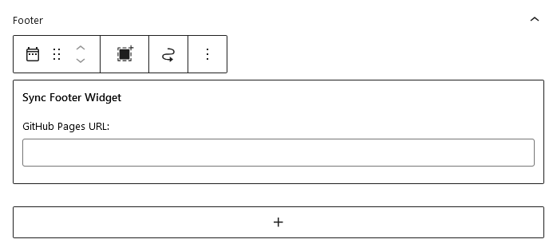

# 🎉 Sync Footer Widget

Sync Footer Widget is a WordPress plugin that fetches footer content directly from a specified GitHub Pages URL and displays it in a widget area. It's built for sites that need to share and centrally manage the same footer content across multiple WordPress installations.

### ✨ Features

- Fetches HTML footer content from GitHub Pages.
- Displays content in a customizable widget area.
- Ideal for websites sharing the same footer content across multiple WordPress installs.
- Works even with Airplane Mode enabled — the plugin disables it specifically for its own requests.

### ✅ Requirements

| Requirement | Version |
| --- | --- |
| WordPress | 5.6 or later |
| PHP | 7.4 or later |
| Tested up to | WordPress 6.7 |

---

### 🚀 Installation

1. Upload the plugin's ZIP file through the WordPress admin panel by navigating to **Plugins > Add New**.
2. Once installed, activate the plugin through the **Plugins** menu.
3. Go to **Appearance > Widgets** to add the "Sync Footer Widget" to your footer area.

### ⚙️ Configuration

Provide a valid GitHub Pages URL in the widget settings to sync the footer content. The URL must point to a publicly accessible page containing HTML content — the plugin fetches it with `wp_remote_get` and outputs the response body as-is.

> [!WARNING]
> The fetched content is rendered without sanitization, so any HTML, CSS, or JavaScript on the page runs directly on your site. Only point this widget at GitHub Pages URLs you control and trust.

---

### 🏆 Usage

Once a widget instance is configured, the plugin renders whatever HTML, CSS, and JavaScript exists at the GitHub Pages URL directly on the front end.

- Works only with publicly accessible GitHub Pages containing HTML content.
- Any embedded CSS or JavaScript on that page is rendered as-is.
- Multiple widget instances can be added across different areas of the site, each pointing to a different URL.

### 📸 Screenshots

| Widget Settings | Front-end Output |
| --- | --- |
|  |  |

---

### ⚡ Changelog

| Version | Changes |
| --- | --- |
| 1.2 | Added compatibility with Airplane Mode; allowed external requests to GitHub Pages via `pre_http_request`; improved error handling for fetching footer content. |
| 1.1 | Removed `wp_kses` for HTML content handling; improved security measures for dynamic content rendering. |
| 1.0 | Initial release with GitHub Page syncing feature. |

### 🛡️ Security

This plugin intentionally skips HTML sanitization so that embedded CSS and JavaScript from the source page render correctly. Treat the configured GitHub Pages URL as a trusted content source, since anything it serves executes on your site with no filtering in between.

### 📜 License

This project is licensed under the [MIT License](LICENSE).

### ✉️ Contact

**Natthasath Saksupanara** — Computer Technical Officer, NIDA  
natthasath.sak@gmail.com
